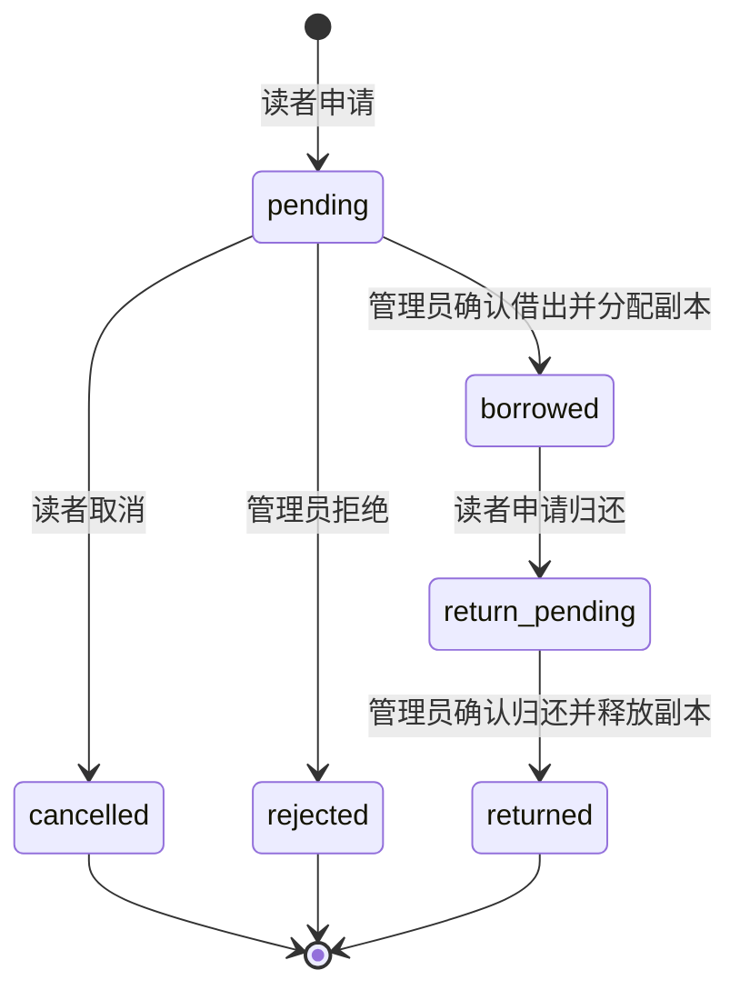

# 实体图书业务使用与验收指南

第一版完成“图书检索 → 读者申请借阅 → 管理员确认借出 → 读者申请归还 → 管理员确认归还”。图书和借阅数据由 FastAPI、SQLAlchemy 与 MySQL 管理，前端使用 Vue 和 Element Plus；无需启用 RAG 或调用云端模型。

## 启动与数据

按 [README](../README.md#本地运行) 准备本地 `backend/.env`，启动 MySQL、FastAPI 和 Vue。默认前端为 `http://127.0.0.1:5173`，接口文档为 `http://127.0.0.1:8000/docs`。只有知识问答需要额外启动 Chroma 和索引 worker。

API 启动时使用 `Base.metadata.create_all` 创建缺失表。书目保存在 `books`，有唯一条码的实体副本保存在 `book_copies`，本阶段新增的申请与流转历史保存在 `book_loans`。已有书目、副本及其他业务数据保留；此流程不会修改已有同名表结构。若已有表结构与模型不符，应先备份并执行经过审查的迁移，不要通过删除数据库重建来更新。

后端默认规则如下，可选地写入本地 `backend/.env`：

```dotenv
BOOK_LOAN_DAYS=30
BOOK_MAX_ACTIVE_LOANS=5
```

不填写时仍使用30天、5册。当前第一版界面按已确认的30天、5册固定展示；若调整后端配置，需要同步更新并验收界面文案。配置修改后重启 API。真实数据库凭证、JWT 密钥和模型密钥只保存在本地 `.env`，不写入示例文件或 Git，也无需发到聊天里。

## 读者操作

1. 登录后打开“图书检索”（`/books`），按书名、作者或 ISBN 搜索，或按分类筛选，查看详情和可借册数。下架书目不出现在读者列表或详情中。
2. 点击“申请借阅”。提交时书目必须上架，且至少有一个实际可借副本；申请成功后状态为“待确认借出”。申请不分配副本、不占库存，也不保证最终借出，因此多位读者可以申请同一书目的最后一本书。
3. 在“我的借阅”（`/loans`）查看进度；待确认借出时可取消。已确认借出后查看条码、馆藏位置、借出时间和应还时间。
4. 交还实体书时点击“申请归还”，状态变为“待确认归还”。等待管理员核对收到的实体书并确认，之后状态变为“已归还”，副本才重新可借。

每位读者最多同时借阅5册，已借出和待确认归还均计入上限，待确认借出申请不计入。借期从管理员确认借出时开始计算30天。逾期可显示提示，首版不做续借和罚款。

同一读者对同一书目只能有一条未结束记录，包括待确认借出、已借出、待确认归还；取消、拒绝或归还后可以重新申请。读者只能查看、取消和申请归还自己的记录。

## 管理员操作

1. 打开“书目与馆藏”（`/admin/books`），新增书目并填写书名、作者及分类。ISBN 可不填；填写时须通过 ISBN 校验且不能与其他书目重复。
2. 为书目新增实体副本，每本具有全馆唯一条码和馆藏位置。副本状态可设为可借、维护中或退役。书目没有实际副本时不可借；副本处于维护中或退役状态时不可借。
3. 打开“借还审核”（`/admin/loans`），按书名、读者姓名/账号和状态筛选。对待确认借出申请可填写原因拒绝，或确认借出。
4. 确认借出时可自动分配或手动选择可借副本。后端会重新检查书目、读者账号、实际库存、借阅上限和申请状态，防止页面数据过期时重复借出。
5. 收到实体书后，对待确认归还的记录点击“确认归还”。确认后释放占用，借阅条码、时间和历史记录保留。

下架书目后不再接受新申请或新借出，已有借阅仍可申请归还并确认归还。借出及待确认归还期间副本不可编辑，不能修改条码、位置或改为维护/退役；需要先完成归还。没有硬删除书目、副本或借阅历史的接口，停用书目使用下架，停止流通副本使用退役。

库存按实际副本和未结束借阅计算：总册数包含可借、维护中的副本，排除退役；可借册数只包含状态为可借且没有有效借阅占用的副本。下架书目的可借数为0。副本本身的流通状态仍使用可借/维护中/退役，借阅占用单独记录，不通过手改库存数量办理借还。

## 状态流转



`pending` 待确认借出，`borrowed` 已借出，`return_pending` 待确认归还，`returned` 已归还，`rejected` 已拒绝，`cancelled` 已取消。状态必须按上述流程转换，重复确认或过期页面操作返回冲突提示。

## API

所有下列路径均以 `/api` 开头，使用登录后取得的 Bearer Token。用户接口要求登录，管理接口要求管理员身份。

| 方法 | 路径 | 权限 | 用途 |
| --- | --- | --- | --- |
| GET | `/books` | 登录用户 | 上架书目分页查询 |
| GET | `/books/{book_id}` | 登录用户 | 上架书目详情与实际库存 |
| GET | `/admin/books` | 管理员 | 书目分页查询，可含下架书目 |
| POST | `/admin/books` | 管理员 | 新增书目 |
| PUT | `/admin/books/{book_id}` | 管理员 | 全量更新书目，含上下架 |
| GET | `/admin/books/{book_id}/copies` | 管理员 | 分页查看副本和借阅占用 |
| POST | `/admin/book-copies` | 管理员 | 登记实体副本 |
| PUT | `/admin/book-copies/{copy_id}` | 管理员 | 全量更新未借出副本，含维护/退役 |
| GET | `/loans` | 登录用户 | 仅查询本人的借阅历史 |
| POST | `/loans` | 登录用户 | 申请借阅，正文 `{"book_id": 1}` |
| POST | `/loans/{loan_id}/cancel` | 记录所属读者 | 取消待确认借出申请 |
| POST | `/loans/{loan_id}/request-return` | 记录所属读者 | 对已借出记录申请归还 |
| GET | `/admin/loans` | 管理员 | 分页查询全部借阅申请与历史 |
| POST | `/admin/loans/{loan_id}/confirm-borrow` | 管理员 | 确认借出；正文 `{}` 自动分配，或 `{"copy_id": 1}` 指定副本 |
| POST | `/admin/loans/{loan_id}/reject` | 管理员 | 拒绝申请，正文 `{"reason": "拒绝原因"}` |
| POST | `/admin/loans/{loan_id}/confirm-return` | 管理员 | 确认已收到实体书并完成归还 |

分页参数为 `page`、`page_size`，每页最多100条。书目支持 `keyword` 和 `category`，管理员书目列表另支持 `is_active=true/false`，省略时包含上下架书目。借阅列表支持 `status`，管理员借阅列表另支持 `keyword`。图书默认每页12条，借阅默认10条。

接口沿用项目统一格式 `{"code": 200, "message": "...", "data": ...}`。不存在的资源及业务冲突使用响应体 `code=404/409`，HTTP 状态仍为200；调用方必须检查业务 `code`。未登录、无管理员权限、请求格式错误分别使用 HTTP 401、403、422。ISBN 或条码重复、库存不足、超借阅上限、状态不符、编辑借出副本均给出业务错误，不能按请求已到达服务器就显示成功。

## 并发与失败处理

借阅写操作在事务中按读者 → 书目 → 借阅记录 → 副本的顺序获取行锁。同一读者的不同书目确认会串行检查上限，同一书目的副本分配也会串行检查库存。影响分配和上限的查询使用锁定当前读，避免 MySQL 可重复读隔离下沿用登录鉴权阶段建立的旧快照；只校验的借阅占用查询使用共享锁，减少交叉借阅时的排他锁等待。

数据库对有效占用的 `active_copy_id` 建立唯一约束，防止同一副本重复借出；对读者和未结束书目组合建立唯一约束，防止重复申请。确认归还只清除有效占用，保留历史 `copy_id`。

校验失败或写入失败会回滚事务。MySQL 死锁1213与锁等待超时1205会回滚并转成业务409，页面提示刷新后重试；刷新后重新确认当前状态，再提交操作。其他数据库连接或语句错误仍作为服务器异常处理，不伪装成可重试的普通业务冲突。

## 自动测试与复验

本阶段自动验证已通过后端208项（含5项 MySQL 并发、1项 MySQL 库存类型契约、2项本地真实 Chroma HTTP、2项真实认证的 SQLite 借还流程）、前端19项和生产构建。另已完成下文记录的本地浏览器自动化验收；仍需由馆方依据实际馆藏与工作流程开展现场验收。

普通后端测试使用内存 SQLite 和测试依赖，不访问真实业务库。以下在项目 `backend` 目录的专用 PowerShell 测试终端执行；环境变量只影响该终端，不修改 `.env`。开启 Chroma 测试会自行启动本地临时 Chroma 进程，结束后清理临时目录，不调用云端模型：

```powershell
$env:DATABASE_URL = 'sqlite:///:memory:'
Remove-Item Env:RUN_LIBRARY_MYSQL_TEST -ErrorAction SilentlyContinue
Remove-Item Env:MYSQL_LIBRARY_TEST_URL -ErrorAction SilentlyContinue
$env:RUN_CHROMA_HTTP_SMOKE = '1'
.venv\Scripts\python.exe -m unittest discover -s tests -v
```

该命令执行202项，另6项 MySQL 测试跳过；与下方单独执行的6项 MySQL 测试合计208项。不需要启动 Chroma 测试时移除 `RUN_CHROMA_HTTP_SMOKE`，对应2项也会跳过。可单独复验真实登录、书目与借还 API 的两项完整流程：

```powershell
.venv\Scripts\python.exe -m unittest discover -s tests -p test_library_flow.py -v
```

MySQL 并发测试在**另一个新开的 PowerShell 终端**执行，工作目录仍为 `backend`，不要沿用上面的 SQLite `DATABASE_URL`：

```powershell
$env:RUN_LIBRARY_MYSQL_TEST = '1'
.venv\Scripts\python.exe -m unittest discover -s tests -p test_loan_mysql.py -v
```

该命令从本地配置读取 MySQL 服务器认证，创建随机命名的 `library_loan_test_<随机值>` 临时库，完全忽略 URL 中的原库名，仅在临时库中建表、写入和测试，并在测试结束后自动清理。服务器账号需有创建和删除该临时库的权限。也可通过本地终端环境变量 `MYSQL_LIBRARY_TEST_URL` 指定测试服务器；真实连接凭证不写入文档、源码或聊天。若 `DATABASE_URL` 已被覆盖为 SQLite 且没有显式指定 MySQL 测试 URL，MySQL 测试会跳过，不能把跳过视为并发验收通过。

六项 MySQL 测试包含五项并发用例：争抢最后一本副本、同一读者不能超5册、同一申请不能重复确认、两名读者交叉借阅、不同书目的间隙锁冲突回滚后重试；另有一项验证真实 MySQL 聚合的库存始终输出 JSON 整数。

前端在项目 `vue-project` 目录运行：

```powershell
node --experimental-vm-modules --test tests/*.test.mjs
npm run build
```

## 本地浏览器验收记录（2026-10-16）

本次使用本机 MySQL、FastAPI 与 Vue，在独立的隐藏 Edge 会话中进行浏览器自动化，使用明确标注的测试书目和副本：

- 实际点击完成读者申请、管理员确认借出、读者申请归还、管理员确认归还。申请不减少库存；确认借出、申请归还、确认归还后的可借库存依次为0、0、1，所分配条码与测试副本一致。
- 图书检索、我的借阅、书目与馆藏、借还审核四个页面在1440与390像素宽度均正常渲染，未发现 JavaScript 或 HTTP 错误、页面整体横向溢出。手机端管理员表格可在自身容器内横向滚动。
- 读者访问管理员书目页被路由守卫拦截；后端权限、所有者和借阅上限另由自动测试覆盖。
- 浏览器验收发现 MySQL 的 `SUM` 返回 `Decimal`，赋值到已创建的响应对象后被序列化成文本。已修复为显式整数，并新增模拟与真实 MySQL 回归测试；重启 API 后，真实 HTTP 响应的库存整数类型复查通过。
- 测试借阅已归还，测试书目已下架、副本已退役，流转历史保留；没有修改既有用户的密码或资料。

八张桌面/手机截图与 `browser-report.json` 保存在 Git 忽略的 `backend/data/library-local-acceptance/`。原始报告保留类型问题的失败观测，`followup_after_stock_type_fix` 记录修复后验证，`final_status` 为 `passed_after_stock_type_fix`。这些本地资料不含模型密钥或登录凭证，不提交到 Git。

## 人工验收清单

1. 管理员新增一条验收书目和两个不同条码的副本，维护其中一个副本；读者应看到总册数2、可借册数1。
2. 两个读者分别申请同一书目；申请后库存不减。管理员只确认其中一个借出后，可借册数应为0，另一个申请不能确认借出。
3. 读者申请归还后，可借册数仍为0；管理员确认归还后恢复为1，原记录保留条码、日期及已归还状态。
4. 检查取消、拒绝后可重新申请；待确认借出、已借出、待确认归还时不能重复申请同一书目。普通读者不可访问管理接口，也不可操作他人的记录。
5. 借出副本不可编辑；下架书目不出现在读者检索中、不能新借出，但已有借阅可以完整归还。借阅达到5册后，包含待确认归还的记录在内，第6册不能确认借出。

演示书目、合成馆规和验收账号仅供测试，不能据此声称学校正式制度或真实馆规 RAG 验收已经完成。图书和借还尚未接入 AI 实时工具调用；Agent、MCP、Harness 与 Docker Compose 不属于本阶段已实现能力。
