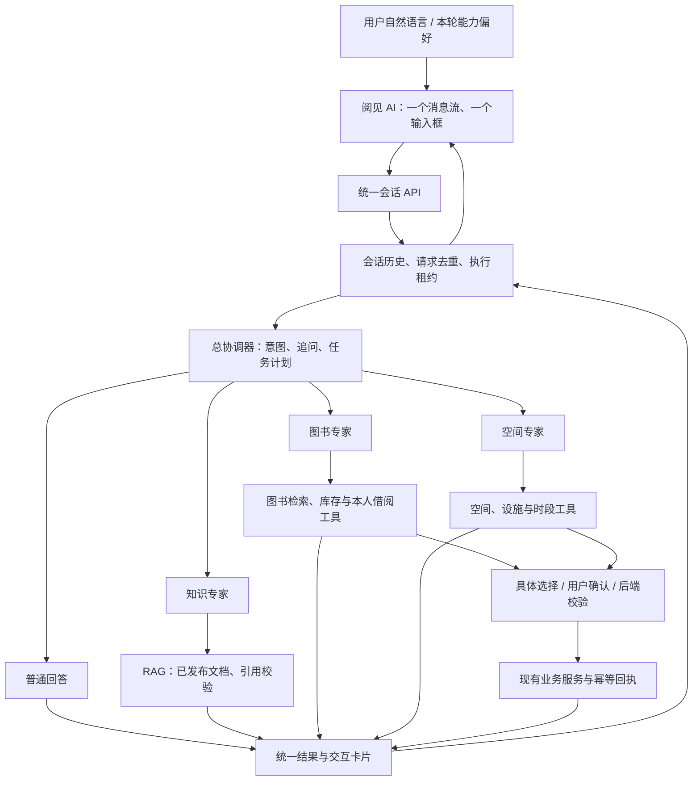
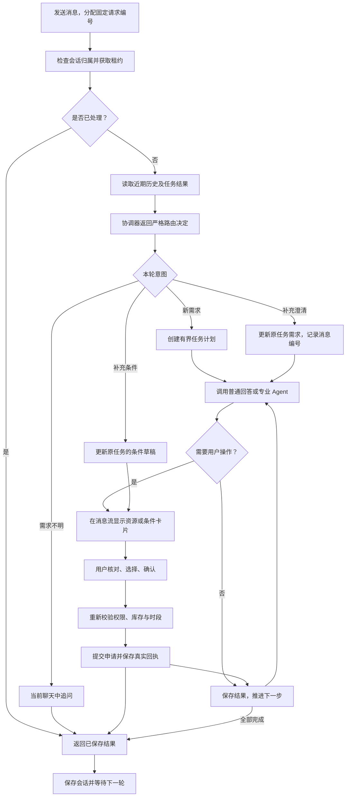

# 阅见 AI：统一会话与多 Agent

## 使用方式

打开 `/assistant`，在同一个聊天窗口输入需求。默认自动识别，也可以点击“查馆规”“找书借还”“预约空间”“聊一聊”表达本轮偏好。这些按钮不切换聊天组件、不清空记录。

例如：“先查研讨室预约规则，再帮我找一本 Python 图书并申请借阅，最后预约研讨室。”
系统按依赖顺序处理知识、图书和空间任务，在消息流中显示回答、资源、条件表单、确认卡片和回执。

- 找书、实时空间查询和个人借阅查询均可单独使用，无须先创建组合任务。
- “第二本还有库存吗”等追问由协调器结合服务端保存的近期对话和有序结果解析，再查询当前数据；指代不清时追问。
- 多个任务可以留在同一会话中等待操作。每项卡片绑定独立任务、步骤和操作编号。
- 预约日期、时段、人数、用途可在聊天中补充，先预填原任务卡片。相对日期由服务端北京时间解析；“周六”等歧义日期提供候选，不自行选择。
- 用户核对查询条件后选择空间，再确认提交申请。借阅和归还同样需要具体选择与确认，最终由管理员办理。
- 刷新恢复当前会话和业务回执。新对话保留原任务，可从“最近对话”返回；桌面与手机都有入口。
- 消息响应丢失时使用原请求编号重试；放弃重试只移除本地重试提示，不撤销已提交申请。

## 整体架构



协调器一次生成至多三个受约束步骤，调用顺序由父工作流保存。图书和预约专家沿用独立 LangGraph 检查点与工具权限。
普通回答和知识问答直接复用现有服务，结果保存到对应步骤。前序结果以受限参考上下文传给后续专家，不能充当实时数据、身份或用户确认。
知识检索只消费已发布资料，保留回答来源；原文预览继续走鉴权接口。普通空间问答使用既有日期解析和只读工具。

## 一轮需求如何执行



每个 HTTP 请求只推进有界阶段。前端自动推进就绪步骤，最多四次请求，遇到选择、确认、条件缺失、失败或预算上限即停止；不会自动发送业务确认。
跳过缺条件的预约步骤可继续后续任务。部分成功保留已完成结果，不自动撤销已提交业务。

## 开发流程与文件映射


| 模块 | 主要文件 |
| --- | --- |
| 会话与消息存储 | `backend/app/models/conversation.py`、`schemas/conversation.py` |
| 会话路由与恢复 | `backend/app/agent/conversation.py`、`coordinator.py` |
| 顺序编排及专家 | `backend/app/agent/workflow.py`、`specialists.py`、`runtime.py`、`graph.py` |
| 回答与证据服务 | `backend/app/services/ai_services.py`、`rag_service.py` |
| 统一 API | `backend/app/api/conversation.py`、`api/__init__.py` |
| 统一界面 | `vue-project/src/views/AssistantView.vue` |
| 卡片、来源与请求 | `components/ConversationTaskCard.vue`、`ConversationAnswer.vue`、`api/conversationApi.js` |

沿用 Vue、FastAPI、SQLAlchemy、LangGraph、DeepSeek、RAG 与 local/MCP，无新增依赖。
旧 `/ai/chat`、`/agent`、`/workflows` 接口保留兼容；产品入口统一使用 `/conversations`。

## API 与存储升级

统一前缀 `/api/conversations`：

| 操作 | 请求 |
| --- | --- |
| 创建或恢复 | `POST /`，`request_id` 为 UUID |
| 查看消息与刷新任务 | `GET /{conversation_id}` |
| 发消息或按原编号重试 | `POST /{conversation_id}/messages`：`request_id`、`text`、`hint` |
| 推进 / 停止 | `POST /{conversation_id}/tasks/{task_id}/retry` 或 `/cancel` |
| 核对预约条件 | 同任务前缀 `/conditions`：完整 `conditions` |
| 选择、确认、分页或跳过 | 同任务前缀 `/steps`：严格匹配操作的 `step_id` 和参数 |

用户身份取自登录态，消息协议不接受 `user_id`、`confirmed` 或其他业务操作参数。
任务操作既校验用户，也校验与当前会话的关联；确认仍绑定具体操作编号。

新增 `agent_conversations` 与 `agent_conversation_turns` 两张表，已有业务表不变。
已有数据库可先预览再增量创建：

```powershell
cd backend
.venv\Scripts\python.exe scripts/upgrade_agent_conversations.py
.venv\Scripts\python.exe scripts/upgrade_agent_conversations.py --apply
```

应用启动也会创建缺失的表。本机开发服务已自动创建，升级预览返回空列表。
前端和 API 使用既有启动方式；MCP、Chroma 及知识 worker 按原指南启动。LangGraph 仍随 API 运行。

## 当前限制

每条需求最多 1000 字、每段会话最多 100 轮、每个任务最多三个步骤。协调器使用近期有界历史和最近五个任务结果，较早且指代不明的内容需要用户补充。
任务保留原有 24 小时有效期；历史消息仍可查看，过期任务需重新发起。
最近对话目录保存在当前浏览器标签页的会话存储中，服务端保存消息和任务；跨设备历史列表与数据保留策略后续实现。
首版顺序执行专家，继续使用本机 SQLite 检查点，不作为多实例部署方案。多个业务申请不构成跨业务数据库事务。

## 2026-10-18 验收记录

最终后端 404 项测试全部通过（含独立 MySQL 和真实 Chroma，无跳过）；离线 Agent Harness 111 项、前端 50 项、改动文件 Prettier 检查和生产构建通过。构建保留既有大包提示。

真实 DeepSeek/MCP 与隐藏 Edge 浏览器在合成账号、图书和空间上完成：

- 一个聊天窗口先普通回答，再组合“知识 → 借阅 → 预约”，并在聊天中补充原预约条件。
- 条件先草稿、再核对；选书与选空间均只准备确认，确认后各生成一条待办申请。
- 重复确认未新增申请；刷新恢复三轮消息、两个任务和原业务回执。
- 桌面 1440×1000、手机 390×844 无横向溢出，无浏览器脚本异常，只有一个聊天输入框。
- 本次馆规问题返回 `insufficient_evidence`；未把无充分引用的内容呈现为可靠规则。正向正式馆规准确率仍需正式语料验收。

报告、截图、离线 Harness 和合成资源清理记录位于 Git 忽略的 `backend/data/conversation-acceptance/`。
合成借阅与预约申请均已取消，合成读者已停用、图书下架、副本撤藏、空间设为维护，保留全部历史。重复升级返回空列表。
浏览器脚本最初误用回执 CSS 选择器导致等待超时，修正后沿用原申请完成恢复与重复确认验收，未重建业务申请。

复验命令：

```powershell
cd backend
.venv\Scripts\python.exe -m unittest discover -s tests -q
.venv\Scripts\python.exe scripts/evaluate_agent.py

cd ..\vue-project
node --experimental-vm-modules --test tests/*.test.mjs
npm run build
```

MySQL 与 Chroma 测试分别设置 `RUN_LIBRARY_MYSQL_TEST=1`、`RUN_CHROMA_HTTP_SMOKE=1`。
MySQL 用随机独立测试库验证，Chroma 使用测试集合；不覆盖业务数据。
